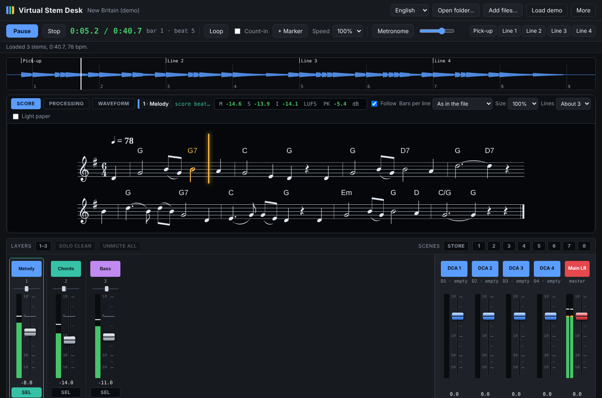

# Virtual Stem Desk

English · [简体中文](README.zh-CN.md)

A mixing console for audio stems that runs entirely in your browser. Drop a folder of stems onto the page and you get a channel strip per track, processing for the selected channel, groups, scenes, a loudness meter, a score that follows the beat, and a WAV export of your mix.

Nothing is uploaded. The audio is decoded and mixed in the browser tab. There is no build step and no server-side code.

**[Open the desk](https://melhzy.github.io/VirtualStemDesk/)** and press **Load demo**, or read the **[tutorials](https://melhzy.github.io/VirtualStemDesk/docs/)**.



## What it does

- **Console layout**: vertical strips with fader, pan, post-fader meter with peak hold, Sel, Mute and Solo; four DCA groups; a main strip with a stereo meter.
- **Selected-channel processing**: high-pass filter, 4-band parametric EQ with a response curve, compressor with a gain-reduction meter.
- **Scenes**: store and recall eight snapshots of the whole desk.
- **Score display**: an ABC score drawn above the faders, with a cursor that follows the song's beat grid through tempo changes. Re-flow it to any number of bars per line, or run it as one scrolling line.
- **Rehearsal tools**: metronome, section buttons, section loops with an optional count-in, markers, beat stepping, 75 % and 50 % speed.
- **Waveform page**: the selected track against the beat grid, with a timing nudge in milliseconds.
- **Loudness**: live momentary, short-term and integrated loudness (ITU-R BS.1770) and peak; the export reports integrated loudness and true peak and can be normalised to a target.
- **MIDI control**: Web MIDI learn mode, plus a preset for controllers that send SQ-style fader-strip messages.
- **Your work is kept**: the desk for each song is saved in the browser and restored when you load the song again.

## Quick start

1. Open <https://melhzy.github.io/VirtualStemDesk/>.
2. Drop a folder of stems (WAV, FLAC, MP3, OGG, M4A) onto the page, or press **Load demo**.
3. Press Space to play. Press **?** for the keyboard shortcuts.

To run it yourself:

```bash
git clone https://github.com/melhzy/VirtualStemDesk.git
cd VirtualStemDesk
python3 -m http.server 8000      # then open http://localhost:8000
```

Opening `index.html` straight from disk also works for your own songs. Only the **Load demo** button needs a web server, because a page opened from disk may not fetch files.

## Tutorials

| | |
|---|---|
| [1. Quick start](docs/quick-start.md) | Load the demo, play, move a fader, export |
| [2. Prepare a song](docs/prepare-a-song.md) | The stems folder, `song.json`, the ABC score |
| [3. Mixing](docs/mixing.md) | Strips, processing, DCAs, scenes, linking, loudness, export |
| [4. Rehearsing with the score](docs/rehearsal.md) | Score display, loops, count-in, markers, waveform and timing |
| [5. MIDI control](docs/midi.md) | Learn mode and the fader-strip preset |
| [6. Questions and limits](docs/faq.md) | Memory, formats, what is not there yet |

## A song folder

```
my-song/
  01_piano.flac
  02_violin.flac
  03_cello.flac
  song.json        optional: title, tempo, sections, names, groups, levels
  tune.abc         optional: the score
```

Only the audio is required. See [Prepare a song](docs/prepare-a-song.md) for every field of `song.json`.

## Languages

The interface is available in English and 简体中文. It follows your browser's language the first time; change it with the selector in the top bar. Track names, section names and song titles are yours and are never translated.

To add a language, copy `lang/zh-CN.js` to `lang/<code>.js`, translate the right-hand side of each entry, and add a `<script>` line for it in `index.html`. The file maps the app's English text to the translation, with a list of patterns for messages that contain numbers or names. No change to `app.js` is needed.

## Browser support

Current Chrome, Edge, Firefox and Safari. MIDI needs a browser with Web MIDI (Chrome, Edge, Firefox). A song is held in memory once decoded: about 23 MB per stereo minute per stem at 48 kHz, less for stems that are silent for part of the song.

## Development

The app is `index.html`, `app.css` and `app.js`, with `i18n.js` and `lang/` for interface languages, plus [abcjs](https://github.com/paulrosen/abcjs) in `vendor/` for drawing the score. Edit and reload. `tools/make_demo.py` regenerates the demo song (numpy only).

The demo in `demo/` is a synthesized arrangement of the traditional tune NEW BRITAIN, which is in the public domain. It contains no recordings or samples.

## Licence

Apache License 2.0. See [LICENSE](LICENSE) and [NOTICE](NOTICE). abcjs is distributed under the MIT licence, included as `vendor/abcjs-LICENSE.md`.

This project is not affiliated with or endorsed by any mixer manufacturer. Where a product name appears, it only describes a MIDI message layout.
