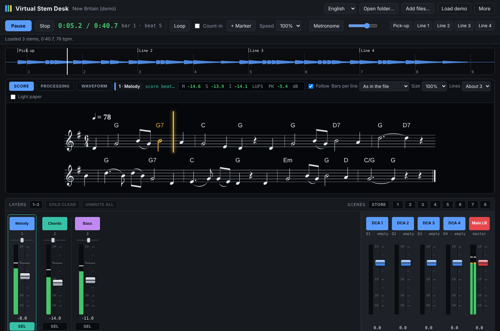

# Virtual Stem Desk（虚拟分轨台）

[English](README.md) · 简体中文

一张完全在浏览器里运行的分轨调音台。把一个装着分轨的文件夹拖到页面上，每一轨得到一条通道条，另有选中通道的处理、编组、场景、响度表、跟着拍子走的谱子，以及把混音导出成 WAV。

不上传任何东西。音频在浏览器标签页里解码和混音。没有构建步骤，也没有服务器端代码。

**[打开分轨台](https://melhzy.github.io/VirtualStemDesk/)**，点“载入演示”（奇异恩典，22 条分轨，约 43 MB）或“小演示”；界面语言在顶栏右侧切换。教程目前是英文：**[Tutorials](https://melhzy.github.io/VirtualStemDesk/docs/)**。



## 能做什么

- **调音台布局**：竖向通道条，带推子、声像、推子后电平表（有峰值保持）、选择、静音、独奏；四个 DCA 编组；主输出条带左右电平表。
- **选中通道的处理**：高通滤波、四段参量均衡（带响应曲线）、压缩（带增益衰减表）。
- **场景**：存储和调出整张台面的 8 个快照。
- **谱子显示**：ABC 谱子画在推子上方，光标沿歌曲的拍点走，速度变化时也跟得上。可以按每行小节数重新排版，或排成一行横向滚动。
- **排练工具**：单曲循环、节拍器、段落按钮、段落循环（可加预备拍）、标记、逐拍移动、75% 和 50% 速度。
- **波形页**：选中的一轨对着拍点显示，可按毫秒微调时间。
- **响度**：实时显示瞬时、短期、整体响度（ITU-R BS.1770）和峰值；导出时报告整体响度和真峰值，并可按目标响度归一。
- **MIDI 控制**：Web MIDI 学习模式，另有一个按 SQ 推子条消息布局的预设。
- **不丢工作**：每首歌的台面保存在浏览器里，再次载入时自动恢复。

## 快速开始

1. 打开 <https://melhzy.github.io/VirtualStemDesk/>。
2. 把分轨文件夹（WAV、FLAC、MP3、OGG、M4A）拖到页面上，或点“载入演示”。
3. 按空格播放。按 **?** 看快捷键。

自己运行：

```bash
git clone https://github.com/melhzy/VirtualStemDesk.git
cd VirtualStemDesk
python3 -m http.server 8000      # 然后打开 http://localhost:8000
```

直接从硬盘打开 `index.html` 也能用来放自己的歌。只有“载入演示”按钮需要网页服务器。

## 歌曲文件夹

```
my-song/
  01_piano.flac
  02_violin.flac
  03_cello.flac
  song.json        可选：标题、速度、段落、轨名、分组、电平
  tune.abc         可选：谱子
```

只有音频是必需的。`song.json` 的每个字段见英文教程 [Prepare a song](docs/prepare-a-song.md)。

分轨建议用 24 位的 WAV 或 FLAC，全部同一个采样率（48 kHz 或 44.1 kHz）。

## 演示歌曲

| 按钮 | 歌曲 | 大小 |
|---|---|---|
| **载入演示** | 奇异恩典，两架钢琴加乐团：22 条分轨，五节，带谱子和跟着演奏走的拍点 | 约 43 MB，载入后占内存约 1 GB |
| **小演示** | New Britain：三条合成的分轨，一节 | 约 5 MB |

奇异恩典的编曲和录音属于 Ziyuan Huang，**不**在 Apache 许可之内：放在这里是为了试用分轨台。请不要再分发这些分轨，也不要从中提取乐器声音。所用乐器：Zauberpiano Cinematic（Decent Samples）、SWAM Violin（Audio Modeling）、Versilian Studios Chamber Orchestra 2 Community Edition，见 [NOTICE](NOTICE)。分轨是 24 位原件的 MP3 拷贝。

## 界面语言

界面有 English 和 简体中文。第一次打开时跟随浏览器语言，之后可在顶栏的选择框里切换。轨名、段落名和歌名是你自己的内容，不会被翻译。

要增加一种语言：把 `lang/zh-CN.js` 复制成 `lang/<语言代码>.js`，翻译每一条右边的文字，再在 `index.html` 里加一行 `<script>`。不需要改 `app.js`。

## 许可

Apache License 2.0，见 [LICENSE](LICENSE) 和 [NOTICE](NOTICE)。abcjs 按 MIT 许可分发，见 `vendor/abcjs-LICENSE.md`。

本项目与任何调音台厂商没有关联，也未获其认可。出现的产品名称只用来说明一种 MIDI 消息布局。
