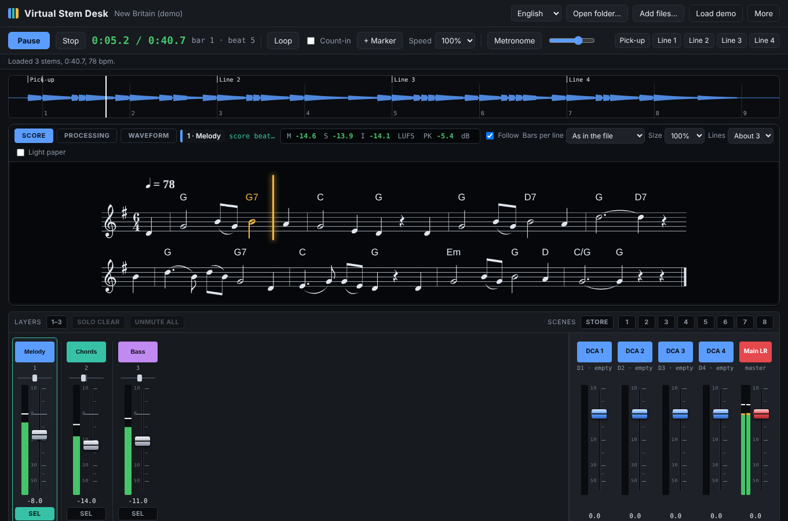

# Virtual Stem Desk tutorials

[Open the desk](../) · The desk itself is in English and 简体中文; these tutorials are in English · [Source on GitHub](https://github.com/melhzy/VirtualStemDesk)

Virtual Stem Desk is a mixing console for audio stems that runs in your browser. These pages take you from the first click to a finished mix.

1. [Quick start](quick-start.md): load the demo, play, move a fader, export. Five minutes.
2. [Prepare a song](prepare-a-song.md): the stems folder, `song.json`, the ABC score.
3. [Mixing](mixing.md): strips, processing, DCAs, scenes, linking, loudness, export.
4. [Rehearsing with the score](rehearsal.md): score display, loops, count-in, markers, waveform and timing.
5. [MIDI control](midi.md): learn mode and the fader-strip preset.
6. [Questions and limits](faq.md): memory, formats, what is not there yet.

## The screen at a glance

From top to bottom:

| Area | What it is for |
|---|---|
| Top bar | Open a folder, add files, load the demo, the More menu |
| Transport | Play, Stop, clock, Loop, Count-in, Marker, Speed, Metronome, section buttons |
| Status line | What the desk just did, and any problem |
| Overview | The whole song: click to go somewhere, Shift-drag to set a loop |
| Display | Three pages: Score, Processing, Waveform. The loudness readout sits in its bar |
| Console | One strip per stem on the left; DCA groups and the main output on the right |
