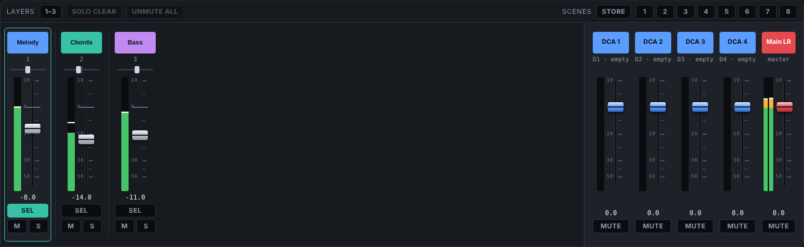
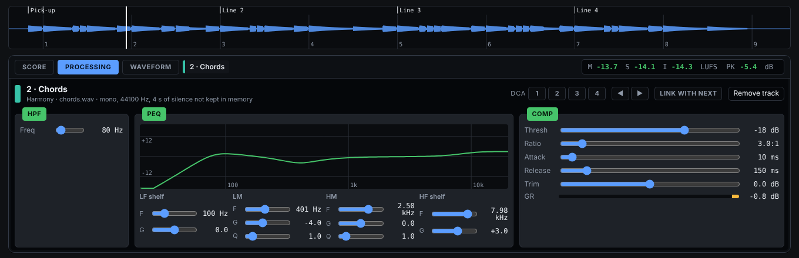

# 3. Mixing

[Back to the tutorials](index.md) · Previous: [Prepare a song](prepare-a-song.md) · Next: [Rehearsing with the score](rehearsal.md)

The layout follows the conventions of a live mixing console: one vertical strip per stem, a processing section for the selected channel, groups and the main output on the right.

## Channel strips

From top to bottom, each strip has:

| Part | What it does |
|---|---|
| Name plate | The track name in its group colour. Click to select the channel without leaving the current display page. Hover for the full name |
| Pan | Left to right position. Double-click to centre |
| Meter | Level after the fader, with a peak-hold line. Green up to -12 dB, amber to 0, red above |
| Fader | -inf to +10 dB, with marks at +10, 0, -10, -30 and -50 |
| dB readout | The fader level |
| Sel | Select the channel and open the Processing page |
| M, S | Mute and solo |

Working the faders:

- Drag anywhere on the fader. It moves from where it is.
- Hold **Shift** while dragging for fine moves.
- **Double-click** for 0 dB.
- Click a fader, then use the arrow keys (1 dB), Page Up and Page Down (6 dB) or the mouse wheel (0.5 dB). The wheel only acts on a fader you have clicked, so scrolling the page cannot change a level.

Above the strips, **Solo clear** and **Unmute all** show how many are active and clear them in one press. The **Layers** buttons jump through the strips sixteen at a time when there are more than fit.

When the window is wide enough, every strip is shown. Otherwise the strip area scrolls sideways.

## Processing the selected channel

Press **Sel** on a strip. The display switches to the Processing page.

Each block has a key that switches it on and off.

| Block | Controls |
|---|---|
| **HPF** | High-pass filter, 20 Hz to 1 kHz. Removes rumble below the instrument |
| **PEQ** | Four bands: low shelf, two bells, high shelf. Each has frequency and gain; the bells also have width (Q). The curve shows the combined response, including the HPF. Double-click a slider to reset it |
| **Comp** | Compressor: threshold, ratio, attack, release and trim. The GR bar shows how much gain it is taking off |

The signal runs HPF, then EQ, then compressor, then fader, then pan.

To the right of the channel name:

- **DCA 1 to 4**: assign the channel to groups.
- **Arrow keys**: move the channel one place left or right.
- **Link with next**: tie the channel to the one on its right. Fader, mute, solo, DCA and processing then move together; pan and timing stay separate. Use it for a left and right pair.
- **Remove track**: take the track off the desk. The file on your disk is not touched.

## DCA groups

A DCA is one fader and one Mute for a set of channels. No audio passes through it: its fader is added to the fader of every channel assigned to it, and its Mute silences them all.

Pull the strings DCA down 4 dB and all the string channels drop 4 dB, keeping the balance between them.

When a song has groups in `song.json`, the first four groups with two or more tracks are assigned to DCA 1 to 4 automatically and the DCA takes the group's name and colour. The small line under the name shows how many channels it controls.

## Scenes

A scene is a snapshot of the whole desk: every fader, pan, mute, solo, DCA and all processing.

- **Store**: press **Store**, then a number from 1 to 8.
- **Recall**: press a lit number.

Use them to compare two balances, or to keep a rehearsal mix and a performance mix side by side.

## Loudness

The readout in the display bar measures the main output to ITU-R BS.1770.

| | |
|---|---|
| **M** | Momentary: the last 0.4 seconds |
| **S** | Short-term: the last 3 seconds |
| **I** | Integrated: everything since the last reset. Click the readout to reset |
| **PK** | The highest sample peak so far. It turns red above -1 dB |

The live reading samples the output many times a second and is meant for watching while you mix. The export measurement is exact.

The main strip on the far right has left and right meters and the main fader.

## Export

**More > Export mix as WAV** renders the mix offline, faster than real time, as a 24-bit WAV.

**More > Export loudness** chooses what happens to the level:

| Setting | Result |
|---|---|
| As mixed | Exactly what the main fader gives |
| -16, -14, -18, -23 LUFS | The export is measured and one fixed gain is applied to reach the target. If the true peak would pass -1 dBTP, the gain stops there and the status line says the file is quieter than asked |

There is no limiter, so the dynamics of your mix are untouched. The status line reports the integrated loudness and true peak of the file.

## Saving

- The desk is saved automatically in the browser, per song.
- **More > Save desk settings** writes everything to a JSON file, including scenes, markers, channel order and links. **Load desk settings** applies such a file to the song that is open. Use this to move a mix to another computer.
- **More > Reset desk** forgets the saved desk and returns to the song's starting levels.
