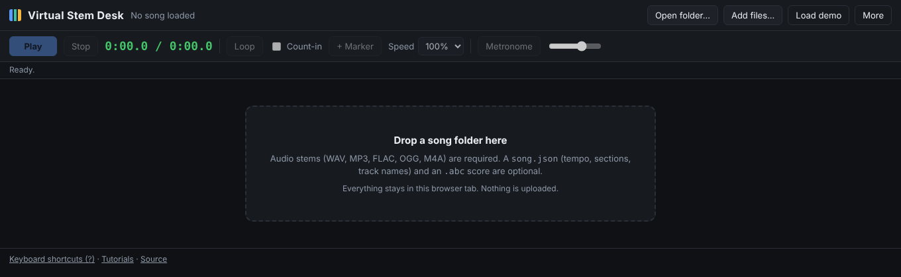
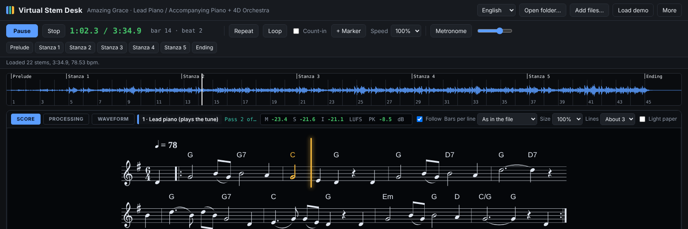
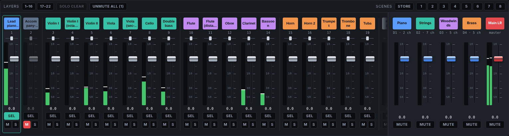

# 1. Quick start

[Back to the tutorials](index.md) · Next: [Prepare a song](prepare-a-song.md)

## Load something

Open the desk. You see an empty page with a drop area.

- Press **Load demo** for Amazing Grace with two pianos and orchestra (22 stems, about 43 MB to download, about 1 GB of memory), or
- press **Small demo** for a 40-second, three-stem song, or
- drag a folder of audio files from your computer onto the page, or
- press **Open folder…** and pick the folder.

The files stay on your computer. The browser reads and decodes them; nothing is sent anywhere.

## Play

Press **Space**, or the **Play** button. Space always means play or pause, whatever you clicked last.

- The clock shows the position, the bar and the beat.
- Click anywhere on the **overview** to go there.
- **Home** goes back to the start. The left and right arrow keys step one beat.
- The section buttons on the right of the transport jump to a section.

## Move a fader

Each stem has a strip at the bottom.

- **Drag a fader** up or down. It moves from where it is and never jumps to the pointer. Hold **Shift** for fine moves. **Double-click** puts it at 0 dB.
- **M** mutes the channel. **S** solos it: only soloed channels are heard. **Esc** clears every solo.
- The small slider above the fader is **pan**. Double-click to centre it.
- The number under the fader is its level in dB.

## Export the mix

Open **More** and choose **Export mix as WAV**. You get a 24-bit WAV at the sample rate of your stems, containing exactly what you hear: faders, pans, mutes, solos, groups and processing. The status line tells you its loudness and true peak, and warns you if it clipped.

## Your work is kept

Close the tab and come back later: when you load the same song again, the desk is as you left it. **More > Reset desk** returns to the song's own starting levels.

## Keyboard

Press **?** on the desk for the full list. The ones you will use most:

| Key | Action |
|---|---|
| Space | Play / pause |
| Home | Back to the start |
| Left, Right | One beat back / forward |
| `[` `]` | Select the previous / next channel |
| M, S | Mute / solo the selected channel |
| Esc | Clear every solo |
| 1, 2, 3 | Display page: Score, Processing, Waveform |
| L | Loop on / off |
| K | Add a marker here |
