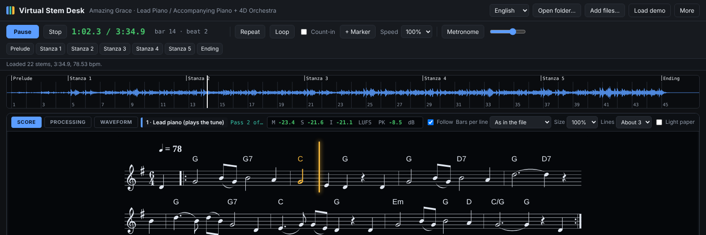
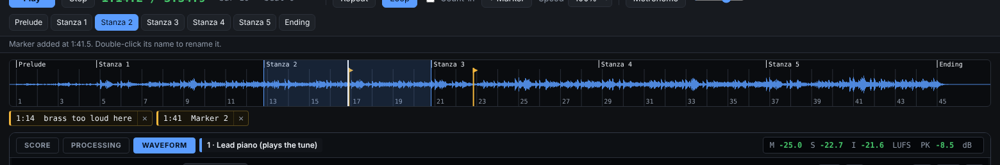
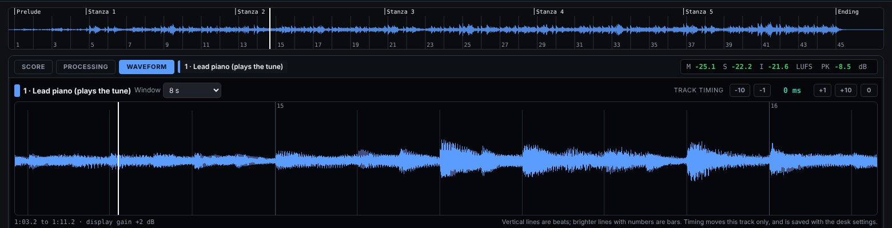

# 4. Rehearsing with the score

[Back to the tutorials](index.md) · Previous: [Mixing](mixing.md) · Next: [MIDI control](midi.md)

## The score display

If the song folder has an ABC file, the **Score** page of the display shows it. A cursor moves through the notes and the note being played lights up.

The cursor follows the song's beat grid, not a fixed tempo. If the recording slows down at the end of a verse, so does the cursor.

Controls on the right of the display bar:

| Control | What it does |
|---|---|
| **Follow** | Keep the line being played in view. Untick it to scroll the score yourself |
| **Bars per line** | Lay the score out again: *As in the file*, *Auto*, a fixed 1, 2, 3, 4, 6 or 8 bars, or *One line, scrolling* |
| **Size** | Notation size, 80 % to 200 % |
| **Lines** | How much of a long score to show: about 3 lines, about 5, or all of it |
| **Light paper** | Dark notes on a light page instead of light notes on the dark display |

### Long scores

A score with more lines than fit scrolls by itself. The line being played sits at the top, with the lines to come below it, so you can always read ahead.

### Crowded bars

If bars are squeezed, choose fewer **Bars per line**, or **One line, scrolling**. In that mode the whole score is one long line at a comfortable spacing; it slides under a cursor that stays about a third of the way across the display. No bar is ever squeezed, however many notes it holds. The clef and key signature appear once, at the far left.

### A verse that repeats

When the score is one verse and the recording plays it five times, set `scoreRepeats` and `scoreBeats` in `song.json`. The cursor returns to the start for each pass, and the display bar shows which pass you are in.

## Metronome

**Metronome** in the transport clicks on every beat of the grid, with a higher click on beat 1. The slider beside it sets its level. It is not part of the export.

## Speed

**Speed** plays at 100 %, 75 % or 50 %. Slower speeds also lower the pitch.

## Repeat

**Repeat** (or **R**) plays the whole song again from the beginning each time it reaches the end, until you press Stop or switch Repeat off. The setting is remembered. It is separate from **Loop**, which repeats a section or a range you choose; when Loop is on, the loop wins.

## Loops

Three ways to choose what to loop:

- **Double-click a section button.** That section loops and its button lights up.
- With **Loop** on, **click a section button**.
- **Shift-drag on the overview.** The ends snap to the nearest beats.

Press **Loop** (or **L**) to switch looping off and on.

Tick **Count-in** and each repeat is preceded by one bar of metronome clicks, which gives a singer or player time to breathe and come in.

## Markers

Press **+ Marker** or **K** to drop a marker at the current position. Markers appear as flags on the overview and as chips below it.

- Click a chip to go there.
- Double-click a chip to rename it, for a note such as "brass too loud here".
- Press the x to delete it.

Markers are saved with the desk.

## Waveform and timing

The **Waveform** page draws the selected channel against the beat grid.

- Thin lines are beats; brighter lines with numbers are bars.
- **Window** sets how much time is shown: 4 to 32 seconds, or the whole song. During playback the view turns a page at a time, so the picture stands still while you read it.
- Click the waveform to go to that point.
- Quiet tracks are drawn larger; the gain used for drawing is shown under the picture and does not affect the sound.

**Track timing** moves the selected track earlier or later in steps of 1 or 10 milliseconds, and **0** puts it back. Use it when one stem sits ahead of or behind the others: watch where its notes start against the beat lines, nudge, and listen. The offset applies to playback and export and is saved with the desk.
